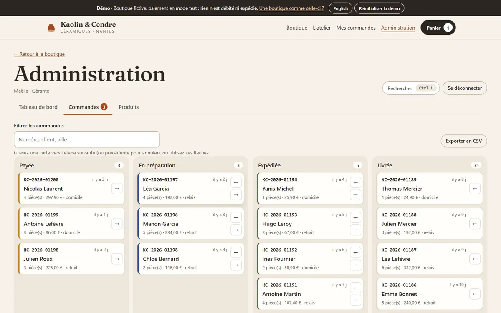
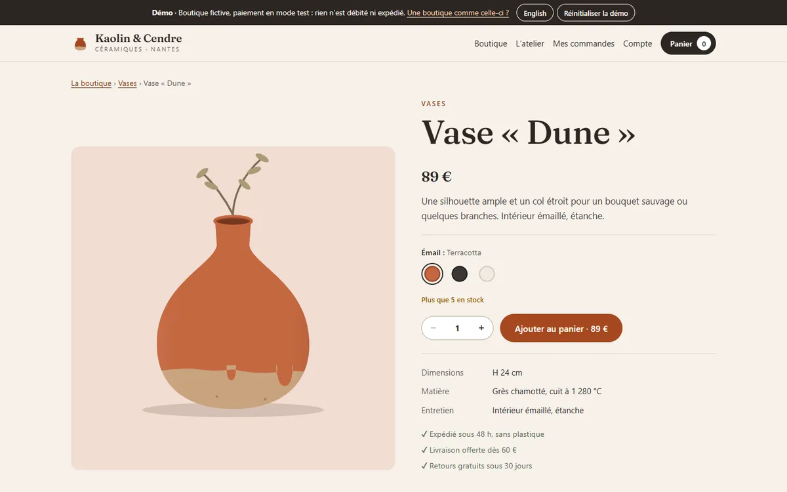
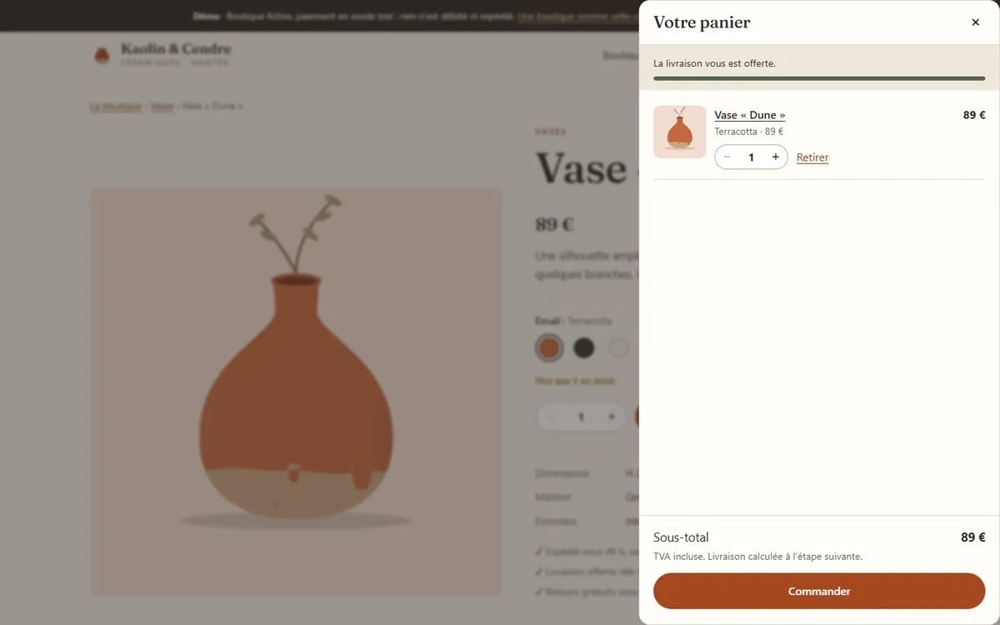
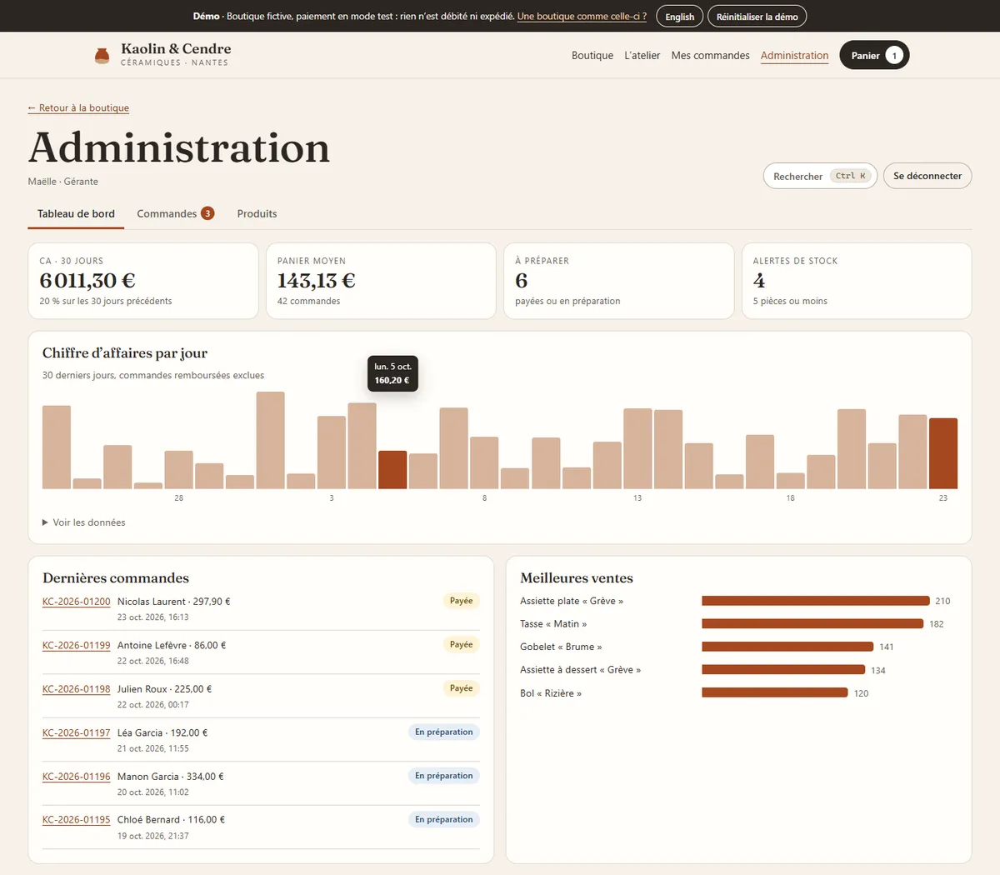
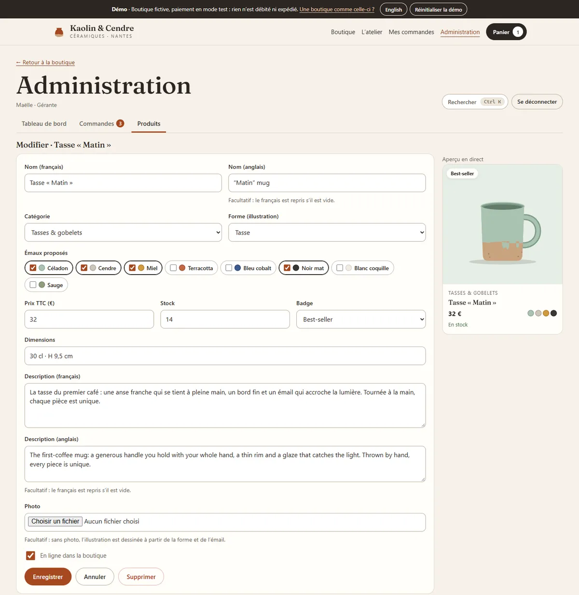
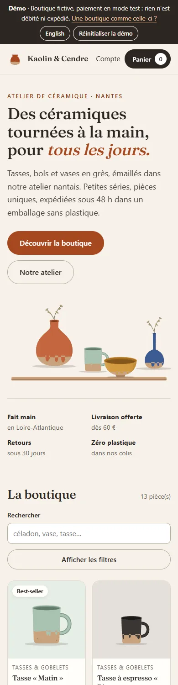
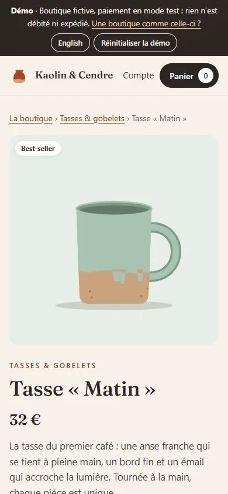
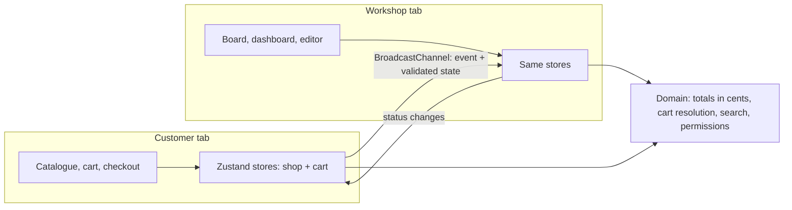

# Kaolin & Cendre · online shop for a ceramics workshop (demo)

[](https://github.com/Barkatzineddine/demo-boutique/actions/workflows/ci.yml)
[](https://barkatzineddine.github.io/demo-boutique/)

[](LICENSE)

A small online shop for a fictional ceramics workshop in Nantes: a filterable catalogue with pieces drawn in SVG, a cart, a three-step checkout with a **clearly labelled test-mode payment**, customer accounts and order tracking, plus an admin with two roles, a drag-and-drop order board, a dashboard and a product editor. Orders appear live in the workshop's tab and their progress live in the customer's. French interface with an English switch, installable, works offline.

**Live: <https://barkatzineddine.github.io/demo-boutique/>** (the admin page lists two demo accounts: a manager and a packer). Nothing is charged or shipped.



## Try it in two minutes

1. **Browse**: search "celadon" (accents don't matter), filter by category, glaze, price or stock. The filters live in the address, so a filtered view can be shared.
2. **Buy**: open a piece, switch the glaze (the drawing changes), add two to the cart, check out with promo code **BIENVENUE10**. Try **Simulate a declined payment** first.
3. Open **Admin** in a second tab with the manager account: your order arrives live. Drag it to "Being prepared": the first tab says so, and the order's timeline moves.
4. While a customer is at the payment step, lower the stock of their piece in the admin: the payment is refused instead of overselling.
5. In **Products**, create a piece (with an optional photo, re-encoded in the browser) and find it in the shop. Sign in as the **packer**: only the order board is left.

## Features

**Shop**
- 13 products in 6 categories, each in several glazes, drawn in SVG from a shape and a glaze: dipped glaze line with drips, speckled clay, shading. No product photos to download, and the drawing follows the glaze you pick.
- Instant accent-insensitive search, combined filters and sorting in the URL; sold-out pieces stay visible, last.
- Cart drawer with a free-delivery progress bar. The cart is re-checked against the live catalogue on every read (deleted or unpublished piece, glaze withdrawn, stock lowered), and several glazes of a piece share its stock.
- Checkout: French address and phone validation, delivery dates in business days, promo code, VAT shown, test card only. Just before the order is created, stock and the total the customer saw are checked again.
- Confirmation with a printable receipt, "my orders" with a dated status timeline that updates live, order lookup by number and e-mail, optional customer account that keeps the address.

**Admin**
- Two roles, enforced in the state functions and not only hidden in the interface: the **manager** has the dashboard, the catalogue, refunds and CSV export; the **packer** only moves orders forward.
- Order board: drag a card to the next step (or back, to undo), or use its arrow buttons; invalid moves are refused; a dialog shows the full order, its history (who, when) and a refund that puts the pieces back in stock.
- Dashboard: revenue over 30 days compared with the 30 before, average basket, orders to prepare, revenue per day, best sellers, stock alerts with one-click restocking, latest orders as they arrive.
- Products: inline stock and visibility, an editor with French and English texts, glazes, live card preview and photo import; Ctrl K searches orders and products.

| Product page | Cart drawer |
| --- | --- |
|  |  |

| Dashboard | Product editor |
| --- | --- |
|  |  |

| Catalogue on a phone | Product on a phone |
| --- | --- |
|  |  |

## Engineering

**Stack:** React 19, TypeScript 6 in strict mode, Vite 8, Zustand, Zod (`zod/mini`), dnd-kit. No UI kit, no router library (a small typed hash router fits GitHub Pages). Every dependency is pinned to an exact version.



- **Money in integer cents** from catalogue to receipt: no floating-point drift in totals, discounts or VAT.
- **The stored cart is a wish list.** It is resolved against the live catalogue on every read, and the order is refused if stock or the total changed since the customer saw it. The same rules a server would apply, written as pure functions and unit-tested.
- **Permissions in the domain.** `moveOrder`, `refundOrder`, `saveProduct` take the staff account and refuse what its role doesn't allow; the interface only reflects it.
- **Everything persisted is validated.** Storage and cross-tab messages go through the same Zod schemas; a hand-edited catalogue (say, a photo URL turned into `javascript:`) is discarded as a whole.
- **Light first load.** The catalogue is in the first bundle; product, checkout, account and admin screens load on demand, and a small build-time service worker precaches them for offline use.
- **Pre-rendered first screen.** After the build, `build/prerender.ts` opens the built app in headless Chrome with empty storage and copies the rendered home page into `index.html`, so a first visit sees it before any JavaScript arrives. The copy is inert, and the app replaces it on its first render without replaying entrance animations; the app's code downloads with the page (`modulepreload`) but runs only after that first paint. A tiny inline script, allowed by its CSP hash, shows the copy only on a first visit: a deep link, saved data or another language never flash the wrong screen. On a simulated mobile 4G line, the home page now appears after 0.70 s instead of 1.48 s. Below the fold, the product drawings and photos wait for the app, so they do not compete with the first screen.

```
src/
  domain/   catalogue constants, schemas, pricing and cart resolution, search, seed data
  state/    shop and cart stores, checkout, order workflow, catalogue editing, accounts, session
  shared/   router, i18n, security helpers, anti-spam, photo re-encoding, UI primitives
  ui/       SVG product art, product card, cart drawer, order timeline
  pages/    Home, Product, Checkout, Orders, Account, Atelier, admin/ (Dashboard, Board, Products)
build/      Vite plugins (CSP meta tag with the boot script's hash, service worker, app preload) and the pre-render step
tests/      unit/ (Vitest) and e2e/ (Playwright)
```

## Quality gates

Every push runs the [CI workflow](.github/workflows/ci.yml); the site is deployed to GitHub Pages only when everything passes.

| Gate | What it checks |
| --- | --- |
| Lint and types | `typescript-eslint` strict, React hooks rules, ban on `innerHTML` and friends; `tsc` strict |
| Unit tests | 89 Vitest tests: totals, cart resolution, delivery dates, search and URL filters, permissions, checkout refusals (stock, changed price, empty cart), order workflow and refunds, accounts and login throttling, photo checks, translations, the service worker's network timeout, the CSP hash of the inlined boot script. Coverage threshold on the logic (95 % of lines) |
| Browser tests | 31 Playwright scenarios on a desktop and a mobile profile: the pre-rendered first screen (shown before the app, replaced without a flash, hidden on deep links and returning visits, readable without JavaScript), filters, glaze picker, full checkout with promo and declined payment, live updates between two tabs, stock lowered during checkout, drag-and-drop board, roles, product creation, photo import, offline mode, axe scans (WCAG 2.2 AA) of every screen, security checks. Any console error fails the test |
| Lighthouse | Lighthouse CI budgets: performance ≥ 90, accessibility 100, best practices 100, SEO ≥ 90 |
| Supply chain | `npm audit`, `npm ci --ignore-scripts`, Actions pinned by commit SHA, Dependabot with a 7-day cooldown |

Lighthouse on the production build (23 October 2026): home **98 / 100 / 100 / 100** on mobile, **100 / 100 / 100 / 100** on desktop; product page 99 / 100 / 100 / 100 on mobile.

## Security

- **No real payment, no card data.** The payment step never asks for a card number: a read-only test card under a "Test mode" banner. In production, payment goes to a PCI-DSS certified provider with 3-D Secure and the shop never sees the card.
- **Strict Content Security Policy with Trusted Types**: scripts, styles, fonts and images from the site only (plus `data:`/`blob:` images for re-encoded photos); the browser refuses any HTML string injection, and a browser test proves it.
- **Safe photo import:** type and size checked (JPEG, PNG, WebP, 5 MB; SVG refused because it can carry scripts), decoded by the browser, cropped and re-encoded on a canvas. EXIF data such as GPS position is dropped, and a disguised file fails to decode (tested).
- **Recomputed, never trusted:** cart, stock, prices and totals are recomputed at each step and once more when paying.
- **Accounts:** PBKDF2-SHA256 (100,000 iterations, random salt), constant-time comparison, no account enumeration, 30-second lock after five failures; only the session's kind and id are kept, in `sessionStorage`. The order lookup gives the same answer whatever was wrong and is rate-limited.
- **Clean input and anti-spam:** invisible and bidi characters removed, length limits, format checks; honeypot field, minimum fill time and rate limit on checkout. CSV export neutralises spreadsheet formulas.
- **No third party:** no CDN, analytics, cookies or trackers.

**Limits, stated plainly:** this is a front-end demo, so the catalogue, orders and accounts live in the browser and the demo accounts are public. In production, the same rules would run on a server (stock reservation in a transaction, payment webhooks, server-side sessions and roles, rate limits), with the CSP sent as an HTTP header.

## Run it locally

Requires Node.js 24.

```bash
npm ci
npm run dev
```

```bash
npm test               # unit tests
npm run test:e2e       # builds, serves and runs the browser tests (uses the installed Chrome locally)
npm run build          # production build in dist/
```

## Credits and license

- Code: [MIT](LICENSE), © 2026 Mohamed Zineddine Barkat.
- Workshop photo: Lodz Design, [CC BY 2.0](https://creativecommons.org/licenses/by/2.0/), via [Wikimedia Commons](https://commons.wikimedia.org/wiki/File:Japanese_wheel_pottery_workshop_02.jpg) (resized). Font: Fraunces, SIL Open Font License, self-hosted.
- Brand, products, customers and orders are fictional. Phone numbers come from the block ARCEP reserves for fiction (06 39 98); e-mail addresses use the reserved `.example` and `example.com` domains.
