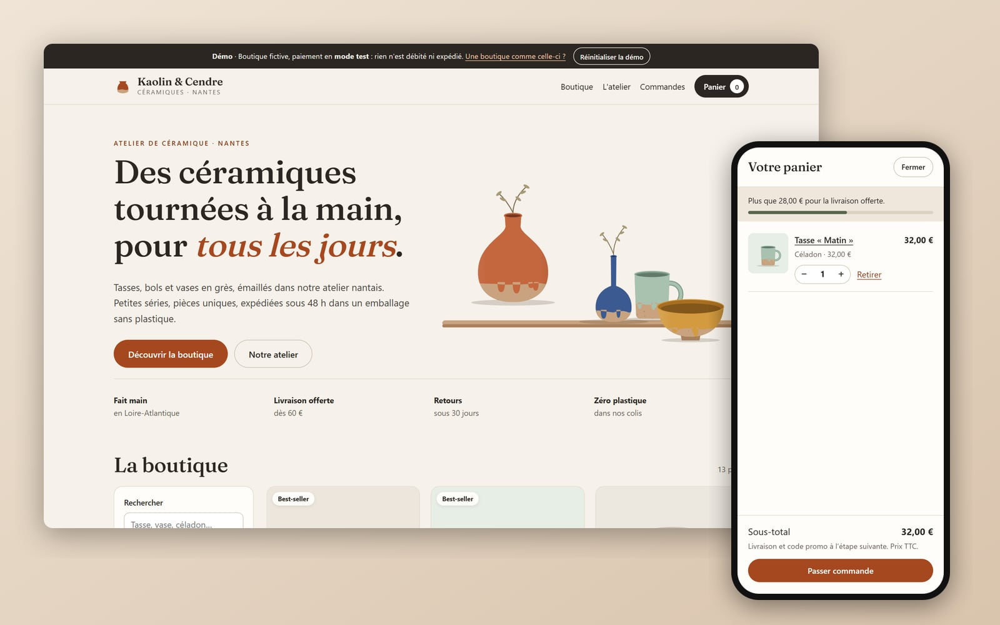
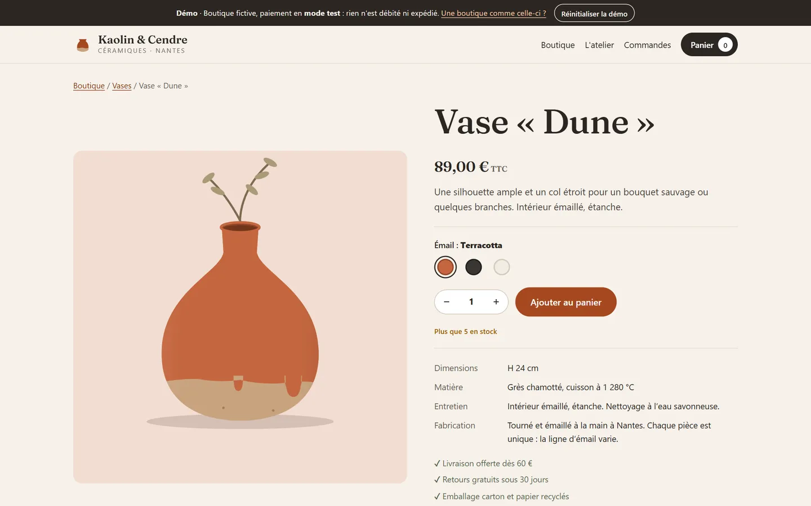
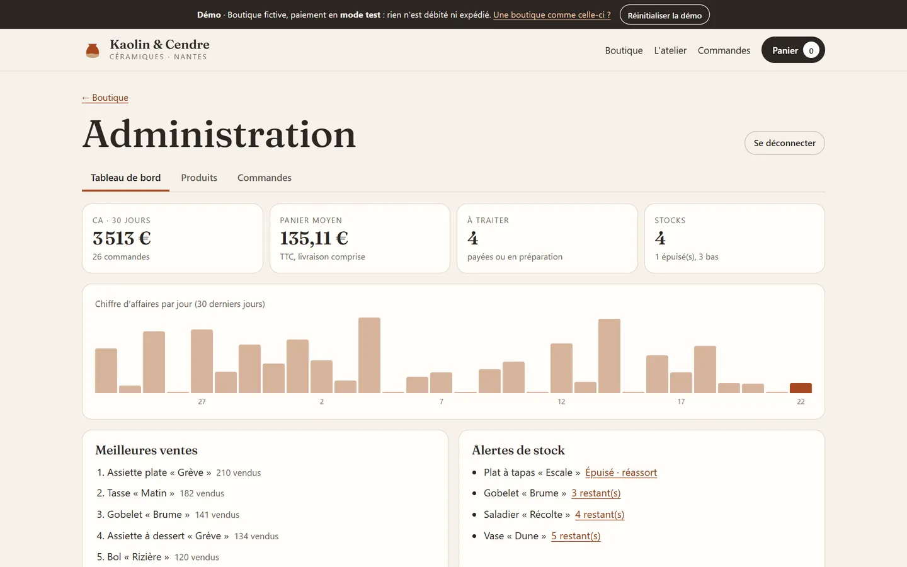
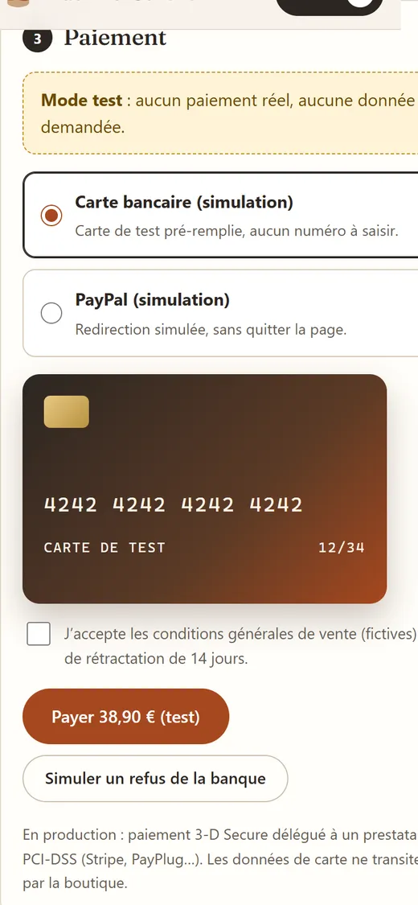

# Kaolin & Cendre · online shop for a ceramics workshop (demo)



**Live demo: https://barkatzineddine.github.io/demo-boutique/** (made for phones first)

A small online shop for a fictional ceramics workshop in Nantes: catalogue with search and filters, product pages, cart, three-step checkout with a **clearly labelled test-mode payment**, order confirmation, order tracking and an admin area to manage products, stock and orders. It is a portfolio piece by [Mohamed Zineddine Barkat](https://barkatzineddine.github.io/). The interface is in French; everything runs in the browser, nothing is charged or shipped.

## Try it

| What | Where |
|---|---|
| Browse | Search ("céladon", "vase"…), filter by category, glaze, price and stock, sort. The filters live in the URL, so a filtered view can be shared. |
| Buy | Open a piece, switch the glaze (the illustration redraws), choose a quantity, add to cart. |
| Checkout | Details → delivery (relay point, home, pick-up at the workshop) → payment in **test mode**. Promo code **BIENVENUE10** gives 10 %. Try **Simuler un refus de la banque** to see a declined payment handled cleanly. |
| Follow an order | **Commandes** shows the orders placed on this device with their status. |
| Admin | Footer → **Administration**, demo PIN **1357**. Move an order to "préparée" and the customer's page updates. |
| Start over | **Réinitialiser la démo** in the top banner. |

## Features

**Shop**
- 13 products in 6 categories, each in several glazes. Products are drawn in SVG from a shape and a glaze ([`art.js`](assets/js/art.js)): dipped glaze line with drips, speckled raw clay, shading. Choosing another glaze redraws the piece, and the catalogue stays light (no product photos to download).
- Accent-insensitive search, combined filters, sorting, out-of-stock pieces kept visible but last.
- Product page with glaze picker, stock-aware quantity, specs, care instructions and related products.
- Cart drawer with free-delivery progress bar; the cart is re-checked against the catalogue on every read (deleted product, changed stock, unpublished piece).
- Checkout: French address and phone validation, delivery dates in business days, promo code, VAT shown (prices include 20 % VAT). Stock is checked again right before the order is created.
- Confirmation page with a printable receipt; order history with a status timeline.

**Admin**
- Dashboard: revenue and orders over 30 days, average basket, orders to process, stock alerts, revenue per day, best sellers.
- Products: inline stock editing, publish / unpublish, full editor with live preview of the product card, optional photo upload.
- Orders: filter by status, move through paid → preparing → shipped → delivered, refund (puts items back in stock), CSV export.

| Product page | Admin |
|---|---|
|  |  |

| Catalogue on a phone | Test-mode payment |
|---|---|
|  |  |

## Security by default

| Measure | How |
|---|---|
| No real payment, no card data | The payment step never asks for a card number: a pre-filled test card is shown, read-only, under a "Mode test" banner. In production, payment goes to a PCI-DSS certified provider (Stripe, PayPlug…) with 3-D Secure, and the shop never sees the card. |
| Strict Content-Security-Policy | `default-src 'none'`; scripts, styles, fonts and images from this site only (plus `data:` and `blob:` images for uploaded photos); `form-action 'none'`, `base-uri 'none'`, `object-src 'none'`. |
| Trusted Types | `require-trusted-types-for 'script'` with `trusted-types 'none'`. No `innerHTML`: elements are built with `createElement`, `textContent` and attribute checks that refuse `javascript:` URLs ([`core.js`](assets/js/core.js)). |
| Safe photo upload | Type and size checked (JPEG, PNG or WebP, 5 MB max), decoded by the browser, cropped and re-encoded on a canvas: EXIF data such as GPS position and camera model is dropped, and a file that is not really an image is rejected. |
| Recomputed, never trusted | Cart, stock, prices and totals are recomputed from the catalogue at each step instead of trusting stored values (the same rule a server applies in production). |
| Clean input and anti-spam | Invisible and bidi characters removed, length limits, format checks; honeypot field, minimum fill time and rate limit on checkout. |
| Defensive storage | Saved data is checked against a schema on load (including the format of uploaded images); corrupt or hand-edited data is discarded. |
| No third party | No CDN, analytics, cookies or trackers. |
| CSV export | Formula injection neutralised. Admin PIN compared as SHA-256 with a lockout (demo only: a real admin sits behind server-side authentication). |

## Performance

Lighthouse on the live site (22 October 2026), mobile profile: **Performance 98, Accessibility 100, Best Practices 100, SEO 100**; desktop profile: 100 on all four. One variable font (37 KB) preloaded, illustrations drawn in SVG, product, checkout and admin code loaded on demand, space reserved for the catalogue so nothing shifts.

## Stack

- HTML, CSS and vanilla JavaScript (ES modules). No framework, no build step, no runtime dependency.
- Font: Fraunces variable, self-hosted (from `@fontsource-variable/fraunces` 5.3.0, SIL Open Font License).
- Hosted on GitHub Pages.

## Run locally

```bash
python -m http.server 8000
```

Then open http://localhost:8000/.

## Project structure

```
index.html             page, CSP, static content
assets/js/core.js      safe DOM builder, storage, input cleaning, anti-spam, dialogs
assets/js/art.js       SVG product illustrations (shape + glaze)
assets/js/data.js      catalogue, delivery options, demo orders, totals, validation
assets/js/state.js     store, cart, "my orders"
assets/js/app.js       router, filters, catalogue, cart drawer
assets/js/product.js   product page
assets/js/checkout.js  checkout, confirmation, order history
assets/js/admin.js     admin area
```

## Credits and license

- Code: [MIT](LICENSE), © 2026 Mohamed Zineddine Barkat.
- Workshop photo: Lodz Design, [CC BY 2.0](https://creativecommons.org/licenses/by/2.0/), via [Wikimedia Commons](https://commons.wikimedia.org/wiki/File:Japanese_wheel_pottery_workshop_02.jpg) (resized).
- Brand, products, customers and orders are fictional. Phone numbers come from the block ARCEP reserves for fiction (06 39 98); e-mail addresses use the reserved `.example` and `example.com` domains.

**Want a shop like this?** [Get in touch](https://barkatzineddine.github.io/#contact).
